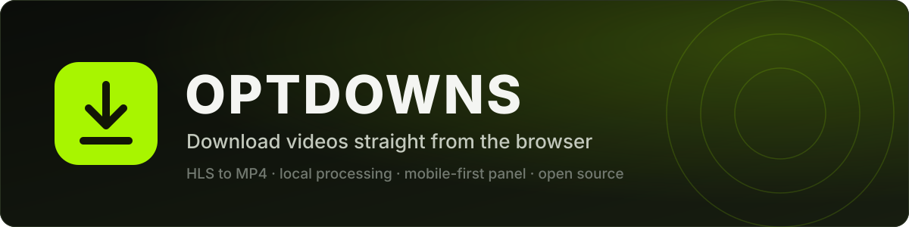
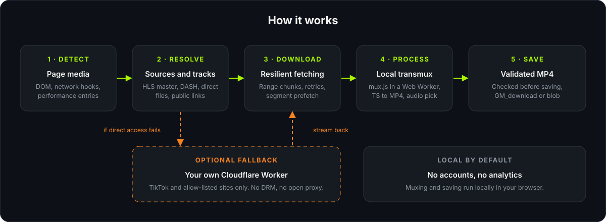
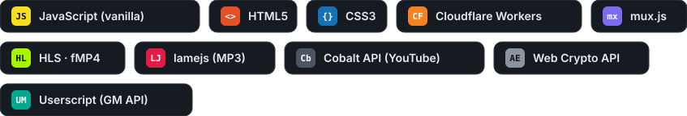

  

  
  
  
  
  

  <b>English</b> · <a href="README.pt-BR.md">Português</a>

---

OPTDOWNS is a userscript that finds the videos on the page you are browsing and saves them as regular MP4 files. It works without a server: HLS streams are downloaded segment by segment and converted to MP4 inside your browser, using [mux.js](https://github.com/videojs/mux.js).

It was built for phones first, so the panel is touch friendly and the save flow takes the quirks of iOS Safari into account. On desktop it behaves the same way.

> The interface is currently in Brazilian Portuguese. Translations are welcome, see [Contributing](#contributing).

## Contents

- [Features](#features)
- [How it works](#how-it-works)
- [Built with](#built-with)
- [Install](#install)
- [Using it](#using-it)
- [Optional Cloudflare Worker](#optional-cloudflare-worker)
- [Configuration](#configuration)
- [Privacy and network behavior](#privacy-and-network-behavior)
- [Limitations](#limitations)
- [Responsible use](#responsible-use)
- [Troubleshooting](#troubleshooting)
- [Credits](#credits)
- [Contributing](#contributing)
- [License](#license)

## Features

- **Finds media on its own.** It watches video elements, network requests, performance entries and page metadata, then lists what it found as cards with thumbnail, duration and resolution.
- **HLS to MP4, on your device.** Reads master and media playlists, lets you pick the video quality and the audio track, downloads the segments with prefetching, and muxes everything into a single MP4 in a Web Worker.
- **Encrypted HLS, within limits.** Streams protected with plain AES-128 and a public key are supported. Anything that needs DRM is refused, not bypassed.
- **Direct files.** MP4, WebM and MOV links are fetched in ranged chunks with retries, so large files do not depend on one long request.
- **Quality picker.** Variants of the same video are grouped, and you choose the quality before the download starts.
- **Download by link.** Paste a link to a file, a playlist, a public TikTok or Instagram post, or a page full of videos. The "This video" and "Videos on the page" sections are kept separate so you can browse the list and pick one.
- **Output checks.** The file is inspected before it is saved, so an HTML error page does not end up named `video.mp4`. After saving you get a short summary of codecs and resolution.
- **Built-in diagnostics.** A report tab runs environment checks, keeps a log of recent errors with suggested fixes, and can copy a report with tokens and cookies masked.
- **Site logos and thumbnails.** Source logos are cached locally, and thumbnails are loaded with the referrer the site expects.

## How it works

  

1. **Detect.** Hooks on `fetch`/`XHR`, a `PerformanceObserver`, a DOM observer and the page metadata feed one list of candidates.
2. **Resolve.** HLS master playlists, DASH manifests, direct files and public pages are turned into concrete options (quality, audio, codec).
3. **Download.** Requests go through the userscript manager's `GM_xmlhttpRequest`, which is what makes cross-origin media reachable. Failures are classified, retried, and in some cases the source page is read again to renew an expired URL.
4. **Process.** HLS segments are converted by mux.js inside a Web Worker, so the page stays responsive.
5. **Save.** The result is validated and then handed to `GM_download` or, on browsers that need it, to a blob download or the share sheet.

## Built with

  

| Part | Technology | Notes |
| --- | --- | --- |
| Userscript | Vanilla JavaScript | One file, no build step, no framework |
| Panel UI | HTML and CSS injected by the script | Mobile-first, inline SVG icons |
| HLS to MP4 | [mux.js](https://github.com/videojs/mux.js) 6.3.0 | Loaded from unpkg, runs in a Web Worker |
| MP4 inspection | Own ISO BMFF box parser | Used to validate output and describe codecs |
| Local decryption | Web Crypto API | AES-128 HLS segments with a public key |
| Optional proxy | Cloudflare Workers | Plain JavaScript, no dependencies, see [`worker/`](worker/) |

## Install

1. Install a userscript manager that supports `@require`, `GM_xmlhttpRequest` and `@connect`, such as Tampermonkey or Violentmonkey.
2. Open the raw file and confirm the install prompt:

   **[optdowns.user.js](https://raw.githubusercontent.com/jmita2288-debug/optdowns/main/optdowns.user.js)**

3. Allow the cross-origin access the manager asks for. The script needs it to read media hosted on other domains.

Updates arrive through the manager's normal update check.

## Using it

Open any page, tap the floating button and the panel slides in.

- **On this page** lists what the script detected while you browse. Pick a quality, tap download, and the progress is shown on the card.
- **By link** takes a pasted URL. Use the clear button to wipe the field and paste the next one. Recent links are one tap away.
- **Sources** shows the kinds of links it understands: public TikTok and Instagram posts, direct video files, `.m3u8` playlists, and pages that contain several videos.
- **Diagnostics** checks the environment, shows recent errors with hints, applies the safe fixes and copies a report you can attach to an issue.

Some sites only release their media inside their own player. When that is the case the script says so instead of guessing.

## Optional Cloudflare Worker

The Worker is a fallback, not a requirement. The script resolves most links by itself in the browser. A Worker helps when a CDN refuses direct requests from the browser, which is common with TikTok links.

**This repository does not ship a hosted Worker, and you should not use someone else's.** Deploy your own copy from [`worker/worker.js`](worker/worker.js). The step-by-step guide, the environment variables and the security model are in [`worker/README.md`](worker/README.md).

Once it is deployed, paste its address into `LINK_PROXY` at the top of the userscript.

## Configuration

The settings live at the top of `optdowns.user.js`:

| Constant | Default | Meaning |
| --- | --- | --- |
| `LINK_PROXY` | `''` | Address of your Worker. Empty means the Worker is never contacted. |
| `LINK_PROXY_KEY` | `''` | Same value as the Worker's `SECRET`, only if you set one. |
| `LINK_PROXY_GENERIC` | `true` | Allow non-TikTok links to use the Worker as a last resort. Set to `false` to send only TikTok links. |

## Privacy and network behavior

OPTDOWNS has no accounts, no analytics and no telemetry. Still, a downloader has to talk to the network, so here is exactly what it does:

- **Media requests** go straight from your browser to the site that hosts the media, through the userscript manager.
- **mux.js** is fetched from `unpkg.com`, pinned to version 6.3.0.
- **Site logos** are requested from public favicon services (Google and DuckDuckGo). Only the site's hostname is sent, and the result is cached in `localStorage`.
- **Local storage** keeps your last few links, the logo cache and a first-run flag. Nothing else is persisted.
- **Your Worker**, if you configure one, receives the link you are downloading and a small test request when you run the diagnostics. Nothing else is sent to it.

The diagnostic report masks tokens, cookies and query strings before you copy it.

## Limitations

- No DRM. Widevine, PlayReady, FairPlay and SAMPLE-AES streams are refused, and so are paywalls and login walls.
- Separate DASH video and audio tracks are not merged.
- Some sites bind their media to the player session, the network or a browser token. Outside the player those URLs are rejected, and the script reports it.
- Sites change. Extraction for a specific platform can break without notice, which is why the diagnostics tab exists.
- iOS Safari can require one extra tap to save. That is a browser rule.

## Responsible use

Use OPTDOWNS for content you have the right to save, such as your own uploads, public-domain or openly licensed videos, and material you are permitted to keep offline. Respect the terms of the sites you visit and the copyright of the people who made the videos.

The project does not remove DRM and does not help with access control of any kind. It is provided as is, and you are responsible for how you use it. It is not affiliated with TikTok, Instagram, Cloudflare or Brightcove.

## Troubleshooting

| Symptom | What to try |
| --- | --- |
| Nothing is detected | Start playback once, then reopen the panel. Check that the manager has the script enabled on that site. |
| HTTP 403, 404 or 410 on download | The signed URL expired. Reopen the video so the page publishes a new one, or paste the page link again. |
| Download opens the video instead of saving | Your browser blocked the automatic save. Use the manual save button the panel shows. |
| `mux.js` did not load | Reinstall with the network on and make sure `unpkg.com` is reachable. |
| A Worker error appears | Run the diagnostics tab, then check `LINK_PROXY`, `ALLOWED_HOSTS`, `TOKEN_KEY` and `SECRET`. |

When you open an issue, attach the report from the diagnostics tab. It is safe to share.

## Credits

OPTDOWNS stands on the work of others:

- **[mux.js](https://github.com/videojs/mux.js)** by Brightcove and the Video.js contributors, Apache-2.0. It does the MPEG-TS to MP4 conversion. See [THIRD_PARTY_NOTICES.md](THIRD_PARTY_NOTICES.md).
- **[Cloudflare Workers](https://developers.cloudflare.com/workers/)** runs the optional proxy.
- **[yt-dlp](https://github.com/yt-dlp/yt-dlp)** is a long-standing reference for how public media endpoints behave. No yt-dlp code is included here.
- **Tampermonkey and the GM API** make a cross-origin userscript like this possible.
- **Google and DuckDuckGo favicon services** provide the site logos.
- **[Shields.io](https://shields.io)** draws the badges above.

## Contributing

Bug reports, translations and pull requests are welcome.

- Open an issue with the diagnostics report, the page type and what you expected.
- Keep changes small and focused. The script is a single file on purpose.
- If you add a platform adapter, make sure it only reads what the page already publishes publicly.
- A translation of the interface strings would help a lot of people. Open an issue first so the approach is agreed.

## Author

Made by [jmita2288-debug](https://github.com/jmita2288-debug). Questions and ideas are welcome in the [issues](https://github.com/jmita2288-debug/optdowns/issues).

## License

Released under the [MIT License](LICENSE). Third-party components keep their own licenses, listed in [THIRD_PARTY_NOTICES.md](THIRD_PARTY_NOTICES.md).
