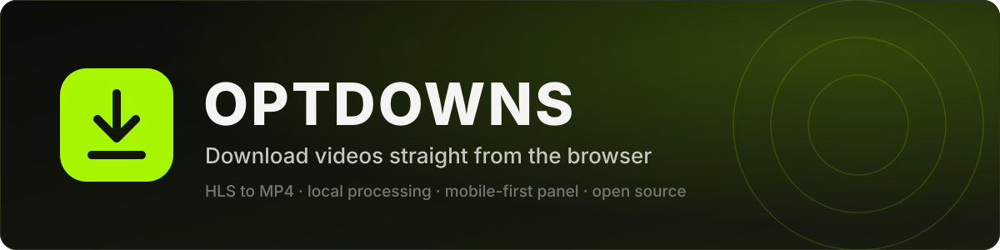
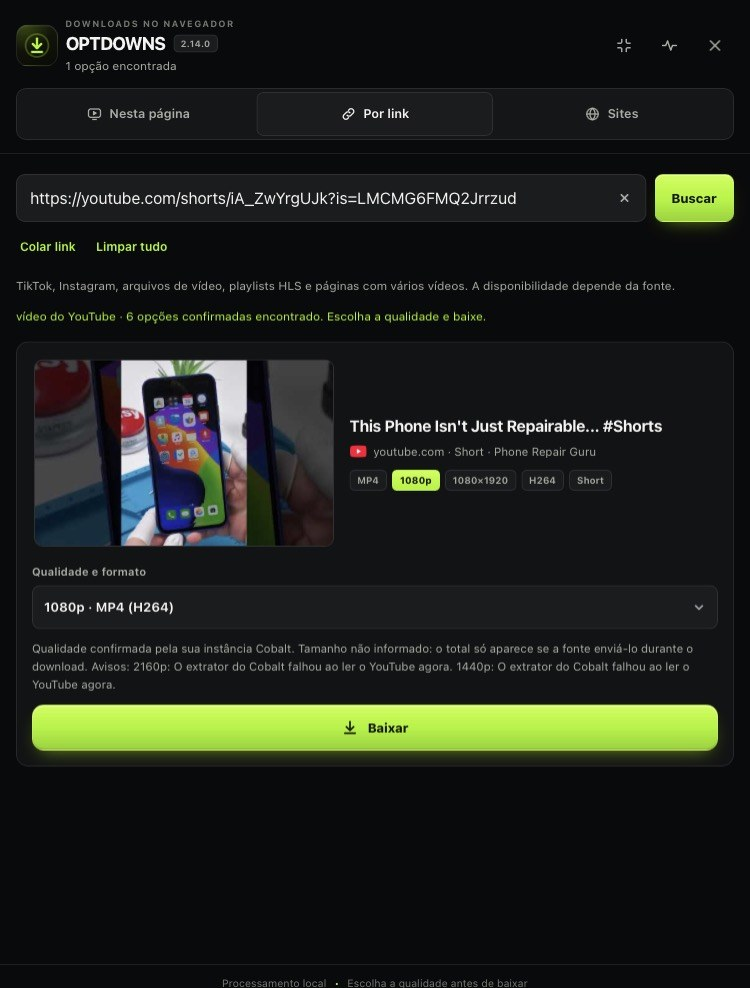
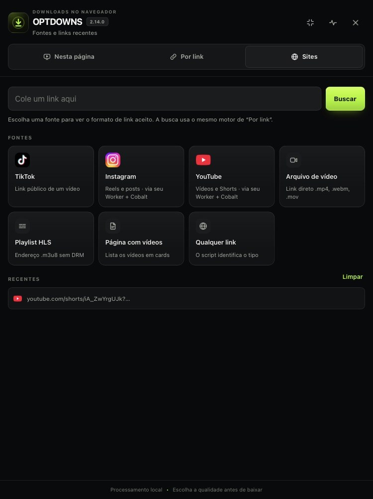
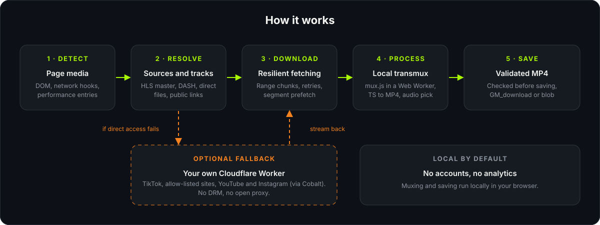
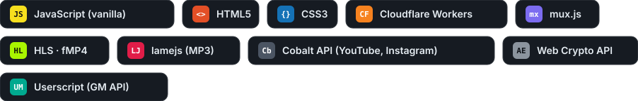

<p align="center">
  
</p>

<p align="center">
  <a href="LICENSE"></a>
  
  
  
  
  
</p>

<p align="center">
  <b>English</b> · <a href="README.pt-BR.md">Português</a>
</p>

---

OPTDOWNS is a userscript that detects the videos on the page you are viewing and saves them as MP4 files. HLS streams are downloaded segment by segment and converted in the browser with [mux.js](https://github.com/videojs/mux.js), so no server is involved. You can also paste the link of a public TikTok, Instagram or YouTube post and choose what to save: video, photos, audio or MP3.

YouTube and Instagram links are resolved by an optional Cloudflare Worker that talks to a [Cobalt](https://github.com/imputnet/cobalt) instance. You deploy both yourself, and the repository does not ship or point to any hosted instance.

The panel is designed for phones first and works the same on desktop. It comes in Portuguese (Brazil), English and Spanish.

<table>
  <tr>
    <td align="center" width="50%">
      <br>
      <sub>By link: a YouTube Short with the quality picker</sub>
    </td>
    <td align="center" width="50%">
      <br>
      <sub>Sites: supported link types and recent links</sub>
    </td>
  </tr>
</table>

## Contents

- [Features](#features)
- [Supported sources](#supported-sources)
- [How it works](#how-it-works)
- [Built with](#built-with)
- [Installation](#installation)
- [Usage](#usage)
- [Configuration](#configuration)
- [Worker and Cobalt](#worker-and-cobalt)
- [What is new in 2.14.0](#what-is-new-in-2140)
- [Testing status](#testing-status)
- [Privacy and network behavior](#privacy-and-network-behavior)
- [Limitations](#limitations)
- [Responsible use](#responsible-use)
- [Troubleshooting](#troubleshooting)
- [Repository layout](#repository-layout)
- [Credits](#credits)
- [Contributing](#contributing)
- [License](#license)

## Features

**Detection and download**

- Finds media from video elements, network requests, performance entries and page metadata, and lists it as cards with thumbnail, duration and resolution.
- Converts HLS to MP4 on the device. It reads master and media playlists, lets you pick the video quality and the audio track, prefetches segments and muxes in a Web Worker.
- Handles HLS encrypted with plain AES-128 and a public key. Anything that needs DRM is refused.
- Downloads direct MP4, WebM and MOV files in ranged chunks with retries.
- Groups variants of the same video and lets you choose the quality before the download starts.
- Checks the file before saving, so an HTML error page is not saved as `video.mp4`.

**Links**

- Accepts links to files, playlists, public TikTok, Instagram and YouTube posts, and pages that contain several videos.
- Saves TikTok and Instagram photo posts one by one or as a ZIP, and audio as MP3 with a selectable bitrate (encoded in the browser with [lamejs](https://github.com/zhuker/lamejs)).
- Lists YouTube qualities from 240p to 2160p, but only the ones your Cobalt instance confirmed.

**Interface**

- Three languages, switched with the flags at the bottom of the panel. The first run follows the browser language and the choice is remembered.
- A download queue, a draggable button and panel, recent links, site logos and a diagnostics tab with a report that is safe to share.

## Supported sources

| Source | Where | Worker | Notes |
| --- | --- | --- | --- |
| Video elements and requests on the current page | On this page | Not used | MP4, WebM, MOV and HLS. No DRM. |
| Direct file or `.m3u8` playlist link | By link | Not used | |
| Page with several videos | By link | Not used | Shown as a list of cards. |
| TikTok: video, photos, audio, cover | By link | Optional | The Worker helps when the CDN refuses the browser. |
| Instagram: Reels, posts, carousels | By link | Optional, uses Cobalt | Falls back to the anonymous public read. |
| Instagram on the current page | On this page | Not used | Detected from the player's network requests. |
| YouTube: videos and Shorts | By link and On this page | Required, uses Cobalt | Stories and playlists are not supported. |
| Other sites | By link | Optional | Last resort, only for hosts you allow-listed. |

## How it works

<p align="center">
  
</p>

1. **Detect.** Hooks on `fetch` and `XHR`, a `PerformanceObserver`, a DOM observer and the page metadata feed one list of candidates.
2. **Resolve.** HLS master playlists, DASH manifests, direct files and public pages become concrete options (quality, audio, codec).
3. **Download.** Requests go through the manager's `GM_xmlhttpRequest`, which is what makes cross-origin media reachable. Failures are classified and retried, and an expired signed URL can be renewed from the source page.
4. **Process.** HLS segments are converted by mux.js in a Web Worker, so the page stays responsive.
5. **Save.** The result is validated and handed to `GM_download` or, where needed, to a blob download or the share sheet.

## Built with

<p align="center">
  
</p>

| Part | Technology | Notes |
| --- | --- | --- |
| Userscript | Vanilla JavaScript | One file, no build step, no framework |
| Panel UI | HTML and CSS injected by the script | Mobile first, inline SVG icons |
| HLS to MP4 | [mux.js](https://github.com/videojs/mux.js) 6.3.0 | Loaded from unpkg, runs in a Web Worker |
| MP3 encoding | [lamejs](https://github.com/zhuker/lamejs) 1.2.1 | Loaded from unpkg, runs in the page |
| MP4 inspection | Own ISO BMFF box parser | Validates output and describes codecs |
| Local decryption | Web Crypto API | AES-128 HLS segments with a public key |
| Optional proxy | Cloudflare Workers | Plain JavaScript, no dependencies, see [`worker/`](worker/) |
| YouTube and Instagram backend | [Cobalt](https://github.com/imputnet/cobalt) API | Your own instance, called only by your Worker |

## Installation

1. Install a userscript manager that supports `@require`, `GM_xmlhttpRequest` and `@connect`, such as Tampermonkey or Violentmonkey.
2. Open the raw file and confirm the installation:

   **[optdowns.user.js](https://raw.githubusercontent.com/jmita2288-debug/optdowns/main/optdowns.user.js)**

3. Allow the cross-origin access the manager asks for. The script needs it to read media hosted on other domains.

Updates arrive through the manager's regular update check.

## Usage

Open any page, tap the floating button and the panel opens.

- **On this page** lists what was detected while you browse. Pick a quality, tap download, and progress appears on the card. On youtube.com the open video is identified from its URL and resolved through the Worker.
- **By link** takes a pasted URL. The clear button empties the field, and recent links are one tap away.
- **Sites** shows the kinds of links it understands, with an example for each.
- **Diagnostics** checks the environment, lists recent errors with hints, applies the safe fixes and copies a report you can attach to an issue.

Some sites only release their media inside their own player. When that happens the script says so instead of guessing.

## Configuration

The settings are at the top of `optdowns.user.js`.

| Constant | Default | Meaning |
| --- | --- | --- |
| `LINK_PROXY` | `''` | Address of your Worker. Empty means the Worker is never contacted. |
| `LINK_PROXY_KEY` | `''` | Same value as the Worker's `SECRET`, only if you set one. |
| `LINK_PROXY_GENERIC` | `true` | Lets non-TikTok sites use the Worker as a last resort. `false` keeps them off the Worker. |
| `LINK_PROXY_YOUTUBE` | `true` | Sends YouTube links to your Worker. `false` turns YouTube off. |
| `LINK_PROXY_YOUTUBE_SIZES` | `false` | Asks Cobalt for each option's size while searching. Sizes show earlier, at the cost of more requests to Cobalt. |
| `LINK_PROXY_INSTAGRAM` | `true` | Uses the Worker and Cobalt for Instagram in By link. `false` keeps the anonymous public read only. |
| `LINK_PROXY_INSTAGRAM_ORDER` | `'cobalt-first'` | `'cobalt-first'` asks Cobalt first and falls back to the public read. `'local-first'` does the reverse. |

## Worker and Cobalt

The Worker is optional for most sources. It is required for YouTube, and it is a fallback for TikTok, Instagram and allow-listed sites. This repository does not host a Worker: deploy your own copy of [`worker/worker.js`](worker/worker.js). The setup guide, variables, routes and security model are in [`worker/README.md`](worker/README.md).

For YouTube and Instagram the Worker calls a Cobalt instance that you run, since Cobalt needs Node and ffmpeg and cannot run on Cloudflare Workers. No public or community instance is built in, because the Cobalt project asks that hosted instances are not used by other projects without permission. See [docs/COBALT.md](docs/COBALT.md).

## What is new in 2.14.0

- **YouTube in "On this page".** The tab identifies the open video from its URL and uses the same Worker flow as "By link", with the same card and download path. Requests are debounced for single-page navigation, and answers for another video are discarded.
- **Instagram in "By link".** Reels, posts and carousels are resolved through the Worker and Cobalt, with a card per carousel item. If the Worker or Cobalt is unavailable, the previous anonymous public read is used.
- **Lighter load on Cobalt.** At most two concurrent calls, spaced out, with retries and backoff on 429, 502, 503 and 504, a short pause after repeated 429, a 20-second cache for permanent failures, and one tunnel per download instead of three.
- **Download checks.** The received size is compared with `Content-Length`, the extension follows the real file type and WebM is never renamed to MP4.
- **Quality ladder.** Resolutions from 240p to 2160p, only when Cobalt confirms them. Above 1080p the source publishes VP9 only, delivered as WebM.
- **Fixes.** The player's `blob:` source no longer creates invalid cards on YouTube, and audio-only answers are no longer listed as video options.
- **Languages.** Portuguese (Brazil), English and Spanish.

The full list is in [CHANGELOG.md](CHANGELOG.md).

## Testing status

The author's automated tests for the YouTube and Instagram work used a simulated Cobalt, YouTube and Instagram (a local test server with the real Worker code, a mocked `fetch` and automated Chromium). Nothing has been validated against the real YouTube or Instagram, a real Cobalt instance, the Cloudflare Workers runtime, Tampermonkey or iOS. Treat those paths as untested and expect to adjust them on first use. The test suites are not part of this repository.

TikTok, HLS and mux.js were not changed in this release and were only compared statically against the previous version.

## Privacy and network behavior

OPTDOWNS has no accounts, analytics or telemetry. A downloader still has to use the network, so this is what it does:

- **Media requests** go from your browser to the site that hosts the media, through the userscript manager.
- **mux.js and lamejs** are fetched from `unpkg.com`, pinned to versions 6.3.0 and 1.2.1.
- **Site logos** are requested from public favicon services (Google and DuckDuckGo). Only the hostname is sent, and the result is cached in `localStorage`.
- **Local storage** and the manager's own storage keep your last few links, the logo cache, the positions of the button and panel, your language choice and a first-run flag.
- **YouTube and Instagram links**, if enabled, go to your Worker. It asks YouTube's oEmbed endpoint for the title and thumbnail, optionally the YouTube Data API for the duration, the public page of an Instagram post for its preview image and title, and your Cobalt instance for the files.
- **Your Worker**, if you configure one, receives the link you are downloading and a small test request when you run the diagnostics.

No API key is stored in the userscript. The diagnostic report masks tokens, cookies and query strings.

## Limitations

- No DRM. Widevine, PlayReady, FairPlay and SAMPLE-AES streams are refused, and so are paywalls and login walls.
- Separate DASH video and audio tracks are not merged.
- YouTube and Instagram depend on your Cobalt instance, and those platforms change often, so expect to update it. Playlists, live streams, Instagram stories and anything that needs a login are not supported. Content behind a login works only if your Cobalt instance has a session configured as its documentation describes.
- With every quality enabled, one YouTube search makes up to seven requests to Cobalt. Against the default limit of a Cobalt instance, about 20 requests per minute, this allows roughly two searches per minute. Reduce `YT_QUALITIES` or raise the limit on your instance for heavy use.
- Some sites bind their media to the player session, the network or a browser token. Outside the player those URLs are rejected, and the script reports it.
- The browser builds the file in memory before saving, so very large downloads can fail on phones. Only a 46.1 MB file was tried in the author's simulated tests.
- Sites change. Extraction for a specific platform can break without notice, which is why the diagnostics tab exists.
- iOS Safari can require one extra tap to save. That is a browser rule.

## Responsible use

Use OPTDOWNS for content you have the right to save, such as your own uploads, public-domain or openly licensed videos, and material you may keep offline. Respect the terms of the sites you visit and the copyright of the people who made the videos. Downloading third-party videos can violate the terms of YouTube and Instagram. For your own YouTube videos, YouTube Studio and Google Takeout are better options.

The project does not remove DRM and does not help with access control of any kind. It is provided as is, and you are responsible for how you use it. It is not affiliated with TikTok, Instagram, YouTube, Cloudflare, Brightcove or the Cobalt project.

## Troubleshooting

| Symptom | What to try |
| --- | --- |
| Nothing is detected | Start playback once, then reopen the panel. Check that the manager has the script enabled on that site. |
| HTTP 403, 404 or 410 on download | The signed URL expired. Reopen the video so the page publishes a new one, or paste the page link again. |
| The download opens the video instead of saving | The browser blocked the automatic save. Use the manual save button the panel shows. |
| `mux.js` did not load | Reinstall with the network on and make sure `unpkg.com` is reachable. |
| YouTube says it is not configured | Set `COBALT_API_URL` in the Worker, then open `/yt/status?key=YOUR_SECRET` or run the diagnostics tab. |
| Errors 429 or 503 from the Worker | Cobalt is rate limiting. Wait for the time shown, reduce `YT_QUALITIES` or raise the limit on your instance. |
| A Worker error appears | Run the diagnostics tab, then check `LINK_PROXY`, `ALLOWED_HOSTS`, `TOKEN_KEY` and `SECRET`. |

When you open an issue, attach the report from the diagnostics tab.

## Repository layout

```
optdowns/
├── optdowns.user.js         Userscript, one file with no build step
├── worker/
│   ├── worker.js            Example Cloudflare Worker
│   └── README.md            Deployment, variables, routes, security model
├── docs/
│   ├── COBALT.md            YouTube and Instagram through Cobalt
│   └── COBALT.pt-BR.md      Same guide in Portuguese
├── assets/                  Images used by the documentation
├── CHANGELOG.md
├── LICENSE
└── THIRD_PARTY_NOTICES.md
```

## Credits

- **[mux.js](https://github.com/videojs/mux.js)** by Brightcove and the Video.js contributors, Apache-2.0. Converts MPEG-TS to MP4. See [THIRD_PARTY_NOTICES.md](THIRD_PARTY_NOTICES.md).
- **[lamejs](https://github.com/zhuker/lamejs)**, a JavaScript port of the LAME MP3 encoder, LGPL-3.0. Encodes the MP3 files.
- **[Cobalt](https://github.com/imputnet/cobalt)** by imput, AGPL-3.0. Used only through its HTTP API, on an instance you run.
- **[Cloudflare Workers](https://developers.cloudflare.com/workers/)** runs the optional proxy.
- **[yt-dlp](https://github.com/yt-dlp/yt-dlp)** is a long-standing reference for how public media endpoints behave. No yt-dlp code is included.
- **Tampermonkey and the GM API** make a cross-origin userscript like this possible.
- **Google and DuckDuckGo favicon services** provide the site logos.
- **[Shields.io](https://shields.io)** draws the badges.

## Contributing

Bug reports, translations and pull requests are welcome.

- Open an issue with the diagnostics report, the kind of page and what you expected.
- Keep changes small and focused. The script is a single file on purpose.
- A new platform adapter should read only what the page already publishes publicly.
- Translations live in the `I18N_ROWS` table of the userscript, one row per text: Portuguese, English, Spanish. Filling in a missing row, or adding a language, is a small pull request.

## Author

Made by [jmita2288-debug](https://github.com/jmita2288-debug). Questions and ideas are welcome in the [issues](https://github.com/jmita2288-debug/optdowns/issues).

## License

Released under the [MIT License](LICENSE). Third-party components keep their own licenses, listed in [THIRD_PARTY_NOTICES.md](THIRD_PARTY_NOTICES.md).
