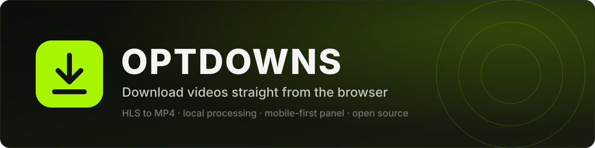
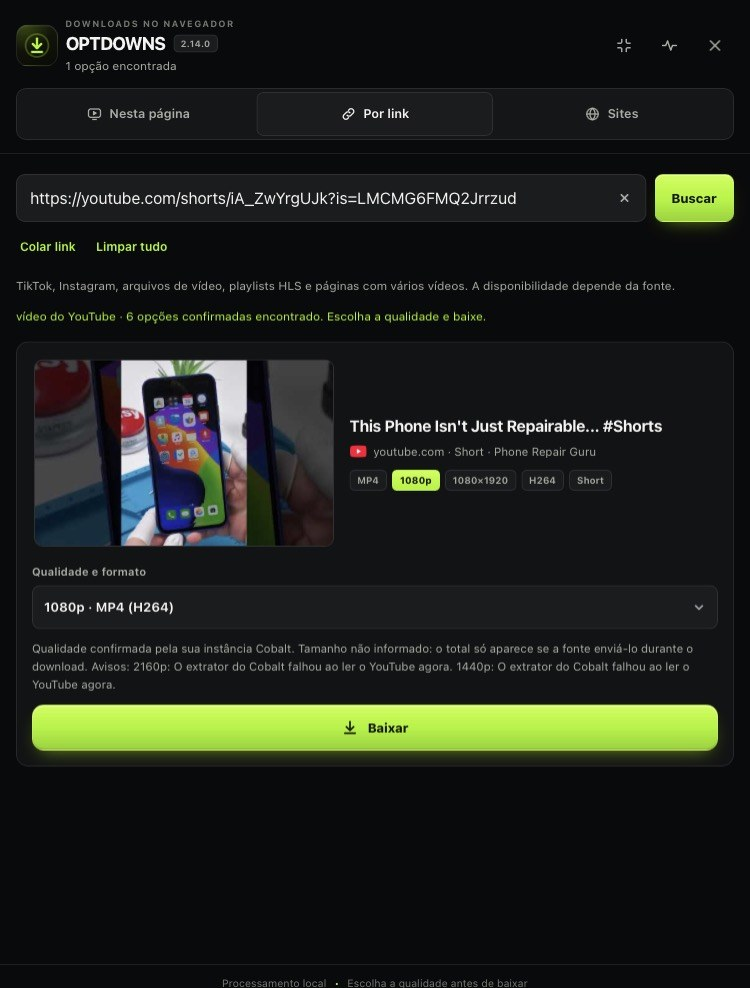
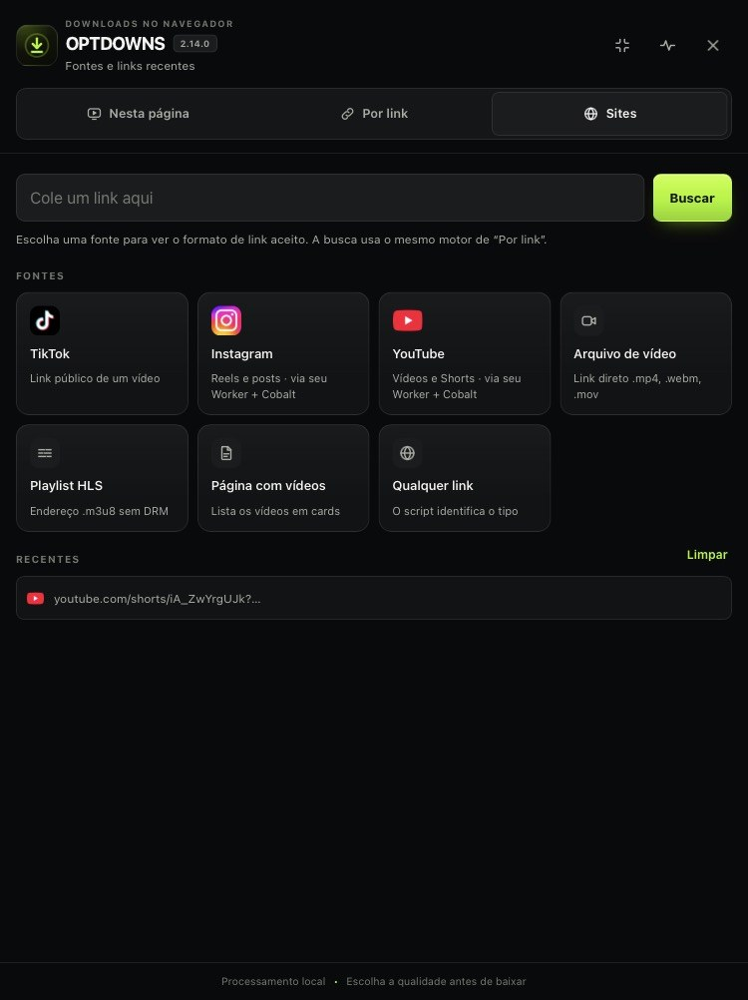
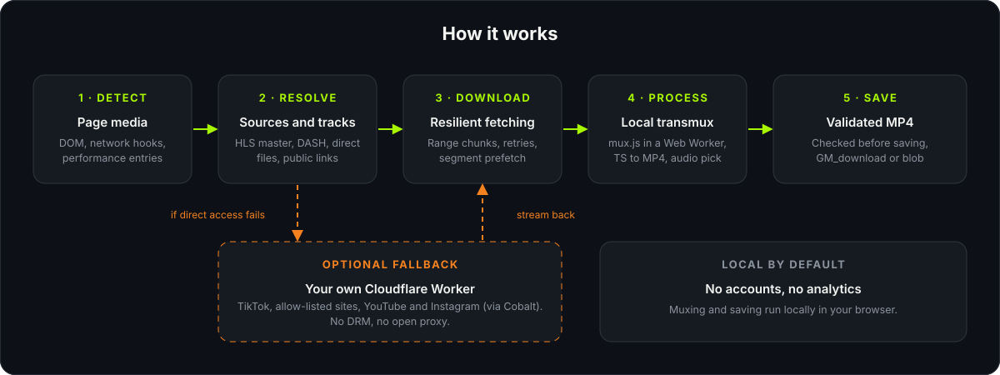
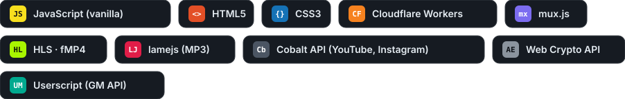

<p align="center">
  
</p>

<p align="center">
  <a href="LICENSE"></a>
  
  
  
  
  
</p>

<p align="center">
  <a href="README.md">English</a> · <b>Português</b>
</p>

---

O OPTDOWNS é um userscript que detecta os vídeos da página que você está vendo e salva cada um como um arquivo MP4. Os streams HLS são baixados segmento por segmento e convertidos no próprio navegador com o [mux.js](https://github.com/videojs/mux.js), sem servidor. Você também pode colar o link de uma publicação pública do TikTok, do Instagram ou do YouTube e escolher o que salvar: vídeo, fotos, áudio ou MP3.

Os links do YouTube e do Instagram são resolvidos por um Cloudflare Worker opcional, que conversa com uma instância do [Cobalt](https://github.com/imputnet/cobalt). Você publica os dois por conta própria, e o repositório não traz nem aponta para nenhuma instância hospedada.

O painel foi pensado primeiro para o celular e funciona do mesmo jeito no computador. Ele vem em português (Brasil), inglês e espanhol.

<table>
  <tr>
    <td align="center" width="50%">
      <br>
      <sub>Por link: um Short do YouTube com a escolha de qualidade</sub>
    </td>
    <td align="center" width="50%">
      <br>
      <sub>Sites: tipos de link aceitos e links recentes</sub>
    </td>
  </tr>
</table>

## Índice

- [Recursos](#recursos)
- [Fontes suportadas](#fontes-suportadas)
- [Como funciona](#como-funciona)
- [Tecnologias](#tecnologias)
- [Instalação](#instalação)
- [Como usar](#como-usar)
- [Configuração](#configuração)
- [Worker e Cobalt](#worker-e-cobalt)
- [Novidades da 2.14.0](#novidades-da-2140)
- [Situação dos testes](#situação-dos-testes)
- [Privacidade e rede](#privacidade-e-rede)
- [Limitações](#limitações)
- [Uso responsável](#uso-responsável)
- [Solução de problemas](#solução-de-problemas)
- [Estrutura do repositório](#estrutura-do-repositório)
- [Créditos](#créditos)
- [Contribuindo](#contribuindo)
- [Licença](#licença)

## Recursos

**Detecção e download**

- Encontra mídia em elementos de vídeo, requisições de rede, entradas de performance e metadados da página, e lista em cards com miniatura, duração e resolução.
- Converte HLS para MP4 no aparelho. Lê as playlists master e de mídia, deixa escolher a qualidade do vídeo e a faixa de áudio, pré-carrega segmentos e junta tudo em um Web Worker.
- Aceita HLS criptografado com AES-128 simples e chave pública. O que exige DRM é recusado.
- Baixa arquivos MP4, WebM e MOV diretos em blocos com Range e novas tentativas.
- Agrupa as variantes do mesmo vídeo e deixa escolher a qualidade antes de o download começar.
- Verifica o arquivo antes de salvar, então uma página de erro em HTML não é salva como `video.mp4`.

**Links**

- Aceita links de arquivos, playlists, publicações públicas do TikTok, do Instagram e do YouTube, e páginas com vários vídeos.
- Salva publicações de fotos do TikTok e do Instagram uma a uma ou em ZIP, e o áudio em MP3 com taxa de bits à escolha (codificado no navegador com o [lamejs](https://github.com/zhuker/lamejs)).
- Lista qualidades do YouTube de 240p a 2160p, mas só as que a sua instância do Cobalt confirmou.

**Interface**

- Três idiomas, trocados pelas bandeiras no rodapé do painel. No primeiro uso segue o idioma do navegador, e a escolha fica salva.
- Fila de downloads, botão e painel arrastáveis, links recentes, logos dos sites e uma aba de diagnóstico com um relatório seguro para compartilhar.

## Fontes suportadas

| Fonte | Onde | Worker | Observações |
| --- | --- | --- | --- |
| Elementos de vídeo e requisições da página atual | Nesta página | Não usa | MP4, WebM, MOV e HLS. Sem DRM. |
| Link direto de arquivo ou playlist `.m3u8` | Por link | Não usa | |
| Página com vários vídeos | Por link | Não usa | Mostrada como lista de cards. |
| TikTok: vídeo, fotos, áudio, capa | Por link | Opcional | O Worker ajuda quando o CDN recusa o navegador. |
| Instagram: Reels, posts, carrosséis | Por link | Opcional, usa o Cobalt | Cai na leitura pública anônima se falhar. |
| Instagram na página atual | Nesta página | Não usa | Detectado pelas requisições do player. |
| YouTube: vídeos e Shorts | Por link e Nesta página | Obrigatório, usa o Cobalt | Stories e playlists não são suportados. |
| Outros sites | Por link | Opcional | Último recurso, só para hosts que você liberou. |

## Como funciona

<p align="center">
  
</p>

1. **Detectar.** Ganchos em `fetch` e `XHR`, um `PerformanceObserver`, um observador do DOM e os metadados da página alimentam uma única lista de candidatos.
2. **Resolver.** Playlists master HLS, manifestos DASH, arquivos diretos e páginas públicas viram opções concretas (qualidade, áudio, codec).
3. **Baixar.** As requisições passam pelo `GM_xmlhttpRequest` do gerenciador, que torna a mídia de outros domínios acessível. As falhas são classificadas e repetidas, e uma URL assinada expirada pode ser renovada a partir da página de origem.
4. **Processar.** Os segmentos HLS são convertidos pelo mux.js em um Web Worker, e a página continua responsiva.
5. **Salvar.** O resultado é validado e entregue ao `GM_download` ou, quando preciso, a um download por blob ou à folha de compartilhamento.

## Tecnologias

<p align="center">
  
</p>

| Parte | Tecnologia | Observações |
| --- | --- | --- |
| Userscript | JavaScript puro | Um arquivo, sem build e sem framework |
| Interface do painel | HTML e CSS injetados pelo script | Mobile first, ícones SVG embutidos |
| HLS para MP4 | [mux.js](https://github.com/videojs/mux.js) 6.3.0 | Carregado do unpkg, roda em um Web Worker |
| Codificação MP3 | [lamejs](https://github.com/zhuker/lamejs) 1.2.1 | Carregado do unpkg, roda na página |
| Inspeção de MP4 | Parser próprio de caixas ISO BMFF | Valida a saída e descreve os codecs |
| Descriptografia local | Web Crypto API | Segmentos HLS AES-128 com chave pública |
| Proxy opcional | Cloudflare Workers | JavaScript puro, sem dependências, veja [`worker/`](worker/) |
| Backend do YouTube e do Instagram | API do [Cobalt](https://github.com/imputnet/cobalt) | Instância sua, chamada só pelo seu Worker |

## Instalação

1. Instale um gerenciador de userscripts que aceite `@require`, `GM_xmlhttpRequest` e `@connect`, como Tampermonkey ou Violentmonkey.
2. Abra o arquivo bruto e confirme a instalação:

   **[optdowns.user.js](https://raw.githubusercontent.com/jmita2288-debug/optdowns/main/optdowns.user.js)**

3. Permita o acesso entre domínios que o gerenciador pedir. O script precisa dele para ler mídia hospedada em outros domínios.

As atualizações chegam pela verificação normal do gerenciador.

## Como usar

Abra qualquer página, toque no botão flutuante e o painel abre.

- **Nesta página** lista o que foi detectado enquanto você navega. Escolha a qualidade, toque em baixar e o progresso aparece no card. No youtube.com, o vídeo aberto é identificado pela URL e resolvido pelo Worker.
- **Por link** recebe uma URL colada. O botão de limpar esvazia o campo, e os links recentes ficam a um toque.
- **Sites** mostra os tipos de link que ele entende, com um exemplo de cada.
- **Diagnóstico** verifica o ambiente, lista os erros recentes com dicas, aplica as correções seguras e copia um relatório que você pode anexar a uma issue.

Alguns sites só liberam a mídia dentro do próprio player. Quando é o caso, o script avisa em vez de tentar adivinhar.

## Configuração

As opções ficam no topo do `optdowns.user.js`.

| Constante | Padrão | Significado |
| --- | --- | --- |
| `LINK_PROXY` | `''` | Endereço do seu Worker. Vazio significa que o Worker nunca é chamado. |
| `LINK_PROXY_KEY` | `''` | Mesmo valor do `SECRET` do Worker, só se você definiu um. |
| `LINK_PROXY_GENERIC` | `true` | Permite que sites que não são o TikTok usem o Worker como último recurso. Com `false`, eles ficam fora do Worker. |
| `LINK_PROXY_YOUTUBE` | `true` | Envia links do YouTube ao seu Worker. Com `false`, o YouTube fica desligado. |
| `LINK_PROXY_YOUTUBE_SIZES` | `false` | Pergunta ao Cobalt o tamanho de cada opção durante a busca. Os tamanhos aparecem antes, com mais requisições ao Cobalt. |
| `LINK_PROXY_INSTAGRAM` | `true` | Usa o Worker e o Cobalt no Instagram em Por link. Com `false`, só a leitura pública anônima. |
| `LINK_PROXY_INSTAGRAM_ORDER` | `'cobalt-first'` | `'cobalt-first'` consulta o Cobalt primeiro e cai na leitura pública. `'local-first'` faz o inverso. |

## Worker e Cobalt

O Worker é opcional para a maioria das fontes. Ele é obrigatório para o YouTube e serve de alternativa para TikTok, Instagram e sites liberados. Este repositório não hospeda um Worker: publique a sua própria cópia de [`worker/worker.js`](worker/worker.js). O passo a passo, as variáveis, as rotas e o modelo de segurança estão em [`worker/README.md`](worker/README.md).

Para o YouTube e o Instagram, o Worker chama uma instância do Cobalt que você mesmo roda, já que o Cobalt precisa de Node e ffmpeg e não roda no Cloudflare Workers. Nenhuma instância pública ou da comunidade vem embutida, porque o projeto Cobalt pede que instâncias hospedadas não sejam usadas por outros projetos sem permissão. Veja [docs/COBALT.pt-BR.md](docs/COBALT.pt-BR.md).

## Novidades da 2.14.0

- **YouTube em "Nesta página".** A aba identifica o vídeo aberto pela URL e usa o mesmo fluxo do Worker de "Por link", com o mesmo card e o mesmo caminho de download. As consultas esperam a URL estabilizar na navegação de página única, e respostas de outro vídeo são descartadas.
- **Instagram em "Por link".** Reels, posts e carrosséis são resolvidos pelo Worker e pelo Cobalt, com um card por item do carrossel. Se o Worker ou o Cobalt estiver indisponível, vale a leitura pública anônima de antes.
- **Menos carga no Cobalt.** No máximo duas chamadas simultâneas e espaçadas, com novas tentativas e espera progressiva em 429, 502, 503 e 504, uma pausa curta depois de 429 repetidos, cache de 20 segundos para falhas definitivas e um túnel por download em vez de três.
- **Verificação do download.** O tamanho recebido é comparado com o `Content-Length`, a extensão segue o tipo real do arquivo e o WebM nunca é renomeado para MP4.
- **Escada de qualidade.** Resoluções de 240p a 2160p, só quando o Cobalt confirma. Acima de 1080p a fonte publica apenas VP9, entregue em WebM.
- **Correções.** A fonte `blob:` do player não cria mais cards inválidos no YouTube, e respostas só com áudio deixaram de aparecer como opção de vídeo.
- **Idiomas.** Português (Brasil), inglês e espanhol.

A lista completa está em [CHANGELOG.md](CHANGELOG.md).

## Situação dos testes

Os testes automatizados do autor para YouTube e Instagram usaram Cobalt, YouTube e Instagram simulados (um servidor de testes local com o código real do Worker, `fetch` simulado e Chromium automatizado). Nada foi validado contra o YouTube ou o Instagram reais, uma instância real do Cobalt, o runtime do Cloudflare Workers, o Tampermonkey ou o iOS. Trate esses caminhos como não testados e espere ajustar algo no primeiro uso. As suítes de teste não fazem parte deste repositório.

TikTok, HLS e mux.js não mudaram nesta versão e só foram comparados de forma estática com a versão anterior.

## Privacidade e rede

O OPTDOWNS não tem contas, análise de uso nem telemetria. Mesmo assim, um downloader precisa usar a rede, então é isto que ele faz:

- **Requisições de mídia** vão do seu navegador para o site que hospeda a mídia, pelo gerenciador de userscripts.
- **mux.js e lamejs** são buscados no `unpkg.com`, fixados nas versões 6.3.0 e 1.2.1.
- **Logos dos sites** são pedidas a serviços públicos de favicon (Google e DuckDuckGo). Só o nome do host é enviado, e o resultado fica em cache no `localStorage`.
- **Armazenamento local** e o armazenamento do próprio gerenciador guardam seus últimos links, o cache de logos, as posições do botão e do painel, o idioma escolhido e uma marca de primeiro uso.
- **Links do YouTube e do Instagram**, se ativados, vão para o seu Worker. Ele consulta o endpoint oEmbed do YouTube para título e miniatura, opcionalmente a YouTube Data API para a duração, a página pública de uma publicação do Instagram para a imagem de prévia e o título, e a sua instância do Cobalt para os arquivos.
- **Seu Worker**, se você configurar um, recebe o link que você está baixando e uma pequena requisição de teste quando você roda o diagnóstico.

Nenhuma chave de API fica no userscript. O relatório de diagnóstico mascara tokens, cookies e query strings.

## Limitações

- Sem DRM. Streams Widevine, PlayReady, FairPlay e SAMPLE-AES são recusados, assim como paywalls e áreas que exigem login.
- Faixas DASH separadas de vídeo e áudio não são mescladas.
- YouTube e Instagram dependem da sua instância do Cobalt, e essas plataformas mudam com frequência, então espere ter que atualizá-la. Playlists, transmissões ao vivo, stories do Instagram e qualquer coisa que exija login não são suportados. Conteúdo atrás de login só funciona se a sua instância do Cobalt tiver uma sessão configurada como a documentação dela descreve.
- Com todas as qualidades ativas, uma busca no YouTube faz até sete requisições ao Cobalt. Com o limite padrão de uma instância do Cobalt, cerca de 20 requisições por minuto, isso permite mais ou menos duas buscas por minuto. Reduza `YT_QUALITIES` ou aumente o limite da sua instância para uso intenso.
- Alguns sites prendem a mídia à sessão do player, à rede ou a um token do navegador. Fora do player, essas URLs são rejeitadas e o script informa.
- O navegador monta o arquivo na memória antes de salvar, então downloads muito grandes podem falhar no celular. Nos testes simulados do autor, só um arquivo de 46,1 MB foi experimentado.
- Sites mudam. A extração de uma plataforma específica pode quebrar sem aviso, e é para isso que existe a aba de diagnóstico.
- O Safari no iOS pode exigir um toque extra para salvar. É uma regra do navegador.

## Uso responsável

Use o OPTDOWNS para conteúdo que você tem direito de salvar, como seus próprios envios, vídeos em domínio público ou com licença aberta, e material que você pode manter offline. Respeite os termos dos sites que você visita e os direitos autorais de quem fez os vídeos. Baixar vídeos de terceiros pode violar os termos do YouTube e do Instagram. Para os seus próprios vídeos do YouTube, o YouTube Studio e o Google Takeout são opções melhores.

O projeto não remove DRM e não ajuda a burlar nenhum tipo de controle de acesso. Ele é fornecido como está, e você é responsável pelo uso que faz dele. Não tem vínculo com TikTok, Instagram, YouTube, Cloudflare, Brightcove ou o projeto Cobalt.

## Solução de problemas

| Sintoma | O que tentar |
| --- | --- |
| Nada é detectado | Inicie a reprodução uma vez e reabra o painel. Confirme que o gerenciador está com o script ativo naquele site. |
| HTTP 403, 404 ou 410 ao baixar | A URL assinada expirou. Reabra o vídeo para a página publicar uma nova ou cole o link da página de novo. |
| O download abre o vídeo em vez de salvar | O navegador bloqueou o salvamento automático. Use o botão de salvar manualmente que o painel mostra. |
| O `mux.js` não carregou | Reinstale com a internet ligada e confirme que o `unpkg.com` está acessível. |
| O YouTube diz que não está configurado | Defina `COBALT_API_URL` no Worker e abra `/yt/status?key=SEU_SECRET` ou rode a aba de diagnóstico. |
| Erros 429 ou 503 do Worker | O Cobalt está limitando as requisições. Espere o tempo indicado, reduza `YT_QUALITIES` ou aumente o limite da sua instância. |
| Aparece um erro do Worker | Rode a aba de diagnóstico e confira `LINK_PROXY`, `ALLOWED_HOSTS`, `TOKEN_KEY` e `SECRET`. |

Ao abrir uma issue, anexe o relatório da aba de diagnóstico.

## Estrutura do repositório

```
optdowns/
├── optdowns.user.js         Userscript, um arquivo sem build
├── worker/
│   ├── worker.js            Cloudflare Worker de exemplo
│   └── README.md            Publicação, variáveis, rotas e segurança
├── docs/
│   ├── COBALT.md            YouTube e Instagram pelo Cobalt (inglês)
│   └── COBALT.pt-BR.md      O mesmo guia em português
├── assets/                  Imagens usadas na documentação
├── CHANGELOG.md
├── LICENSE
└── THIRD_PARTY_NOTICES.md
```

## Créditos

- **[mux.js](https://github.com/videojs/mux.js)**, da Brightcove e dos colaboradores do Video.js, Apache-2.0. Converte MPEG-TS para MP4. Veja [THIRD_PARTY_NOTICES.md](THIRD_PARTY_NOTICES.md).
- **[lamejs](https://github.com/zhuker/lamejs)**, uma versão em JavaScript do codificador MP3 LAME, LGPL-3.0. Codifica os arquivos MP3.
- **[Cobalt](https://github.com/imputnet/cobalt)**, da imput, AGPL-3.0. Usado só pela API HTTP, em uma instância que você roda.
- **[Cloudflare Workers](https://developers.cloudflare.com/workers/)** executa o proxy opcional.
- **[yt-dlp](https://github.com/yt-dlp/yt-dlp)** é uma referência de longa data sobre como os endpoints públicos de mídia se comportam. Nenhum código do yt-dlp está incluído.
- **Tampermonkey e a GM API** tornam possível um userscript entre domínios como este.
- **Serviços de favicon do Google e do DuckDuckGo** fornecem as logos dos sites.
- **[Shields.io](https://shields.io)** desenha os selos.

## Contribuindo

Relatos de bugs, traduções e pull requests são bem-vindos.

- Abra uma issue com o relatório de diagnóstico, o tipo de página e o que você esperava.
- Mantenha as mudanças pequenas e focadas. O script é um arquivo único de propósito.
- Um adaptador de nova plataforma deve ler só o que a página já publica de forma pública.
- As traduções ficam na tabela `I18N_ROWS` do userscript, uma linha por texto: português, inglês, espanhol. Completar uma linha que falta, ou adicionar um idioma, é um pull request pequeno.

## Autor

Feito por [jmita2288-debug](https://github.com/jmita2288-debug). Dúvidas e ideias são bem-vindas nas [issues](https://github.com/jmita2288-debug/optdowns/issues).

## Licença

Distribuído sob a [Licença MIT](LICENSE). Os componentes de terceiros mantêm suas próprias licenças, listadas em [THIRD_PARTY_NOTICES.md](THIRD_PARTY_NOTICES.md).
